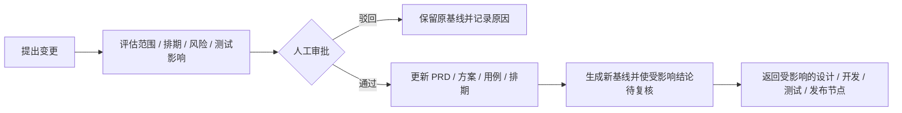

# Harness 研发工作台 V2：版本主线与 AI 对话主工作区

日期：2026-10-03（Asia/Shanghai）
状态：根据用户选择的图 1 和完整研发流程附图修订的设计方案，尚未实施业务功能。

交付：[修订设计原图](/Users/wangyang/ai/ai_deepseek_harness/output/imagegen/04-version-ai-primary-v2.png) · [完整生成提示词](/Users/wangyang/ai/ai_deepseek_harness/docs/design/image-prompts-v2.md)

实施拆分：[两阶段任务计划](/Users/wangyang/ai/ai_deepseek_harness/docs/superpowers/plans/2026-10-03-ai-native-rd-two-phase-plan.md)。按用户最新要求，一期先搭建完整主线框架，二期深化 AI 能力与自动化。

## 1. 本轮确定的方向

用户偏向第一张版本中心设计，但认为 AI 对话区域被弱化。本轮保留它的版本主线、左侧导航和浅色视觉，把持续对话变成默认主工作区，并按用户附图覆盖完整六阶段。

**版本回答“这次交付什么、到哪一步”；对话承载“现在一起做什么”；任务和产物说明“形成了什么、还缺什么”。**

原方案的右侧小助手改为约占业务区域 60% 的主对话区。AI 不仅提示风险，还能结合上下文生成需求、方案、代码与测试产物，呈现差异和操作入口。角色审批、业务状态和执行证据仍由明确的业务记录承载。

完整产品方向覆盖六阶段。依据用户最新的两期要求，一期搭建六阶段的基础数据、节点、对话、产物与流转，保留真实对话创建需求和本地 Harness 开发；发布、灰度、复盘等复杂环节先支持外部操作和人工记录。二期深化各节点的 AI 能力、外部连接器与自动化执行。

## 2. 页面布局

目标为桌面 Web。修订图沿用图 1 的画布比例，目标 1487 × 1058。

| 区域 | 默认布局 | 作用 |
|---|---|---|
| 左侧导航 | 约 180px，可折叠 | 项目、我的工作、需求池、版本、工作区、测试 |
| 顶部版本信息 | 常驻 | 版本目标、实际所处阶段、负责人、发起变更入口 |
| 六阶段导航 | 一行，可点击阶段 | 全流程进展；选择阶段后查看该阶段任务和对话 |
| AI 主对话区 | 剩余业务宽度约 60%，在左 | 连续对话、实际执行状态、可追溯结果、可操作产物卡、较大的常驻输入框 |
| 任务与产物区 | 剩余业务宽度约 40%，在右 | 当前阶段节点、并行评审、文档、证据和人工结论 |
| 需求变更入口 | 顶部入口，底部简洁流程提示 | 从任意阶段提出变更，查看影响与审批情况 |

对话区与任务区允许拖动分隔线。提供「专注对话」，展开后暂时收起任务区；展开文档或代码差异时也可临时放大产物区。恢复布局后保留原选择和滚动位置。

六阶段导航只显示阶段与状态，31 个节点按阶段展开。版本当前实际阶段与用户正在浏览的阶段分别标识，点击历史阶段不推进业务状态。

## 3. 六阶段与附图节点对应

以下以用户提供的流程图为完整业务依据，保留节点编号。编号用于节点映射和追踪；它不要求所有需求串行执行。

| 阶段 | 节点 | 核心产物 |
|---|---|---|
| 1. 需求与立项 | **01** 需求收集；**02** 需求补充与澄清；**03** 需求评审；**04** 立项与版本排期 | PRD、需求池、版本目标、项目计划 |
| 2. 设计与评审（并行） | **05** 技术影响分析；**06** 技术方案设计；**07** 技术方案评审；**08** 测试方案与用例评审；**09** UI / 交互 / 产品评审；**10** 安全 / 合规 / 性能评审（按需）；**11** 评审结论与范围冻结 | 技术方案、测试用例、设计稿、评审结论、冻结基线 |
| 3. 开发与 Review | **12** 任务拆分与开发计划；**13** 开发实现；**14** 开发自测；**15** 代码 Review；**16** 持续集成 CI；**17** 联调准入 | 任务与工作区绑定、代码提交、CR 记录、构建产物、自测报告、提测批次 |
| 4. 测试与验收 | **18** 测试执行；**19** 缺陷管理；**20** 测试通过 / 提测准出；**21** UAT / 验收确认 | 测试报告、缺陷与回归记录、风险清单、业务验收结论 |
| 5. 发布与灰度 | **22** 发布准入评审；**23** 正式构建 / 制品管理；**24** 灰度发布；**25** 灰度分析；**26** 全量发布；**27** 发布验证 / 回滚 / 热修复 | 发布制品、上线记录、灰度报告、发布验证、回滚与热修复记录 |
| 6. 运营反馈与沉淀 | **28** 效果分析；**29** 版本复盘；**30** 知识沉淀；**31** 需求回流 / 下一版本规划 | 指标分析、复盘报告、知识条目、下一轮需求与改进项 |

附图节点 20 使用“测试通过 / 提测准出”。页面文案建议统一为“测试准出”，表示系统测试结束、进入 UAT；节点 17 承载开发侧提测准入，避免两个阶段的“提测”含义混淆。节点映射保留，不改动附图的业务先后关系。

开发工作区选择作为节点 13 开始前的必需步骤：选择执行机器、仓库、分支或独立 worktree，再在授权范围内修改代码。节点 15、16 可在开发过程中多次执行；节点 17 以本次候选提交和构建的 CR、CI、自测结论为准。

## 4. AI 对话如何成为主要工作方式

### 4.1 输入天然承接业务上下文

输入框上方常驻显示当前版本、阶段、需求或提测批次。用户可以说：

- “创建一个播放失败后重试的需求，补齐验收标准，放进 v1.8.0。”
- “检查这个版本是否满足评审条件，列出还没解决的问题。”
- “补充网络恢复场景，然后发起测试方案复审。”
- “使用我选定的工作区实现这条已评审需求。”
- “基于这次提交整理提测说明和回归建议。”
- “分析这条变更会影响哪些代码、用例和版本排期。”

这些表达形成具体的业务操作草稿或执行任务。对象明确、权限和阶段满足时，可按既有授权执行；涉及人工评审结论、范围冻结、发布等节点时，显示对应责任人的操作入口。

### 4.2 对话产出可编辑、可操作的对象

对话中可直接显示需求草稿、方案、用例、代码差异、检查结果、提测单和变更评估卡。每张产物卡标明所属对象、修订、生成状态及可执行动作，例如：

| 对话产物 | 操作示例 | 实际落点 |
|---|---|---|
| 需求草稿 | 查看差异、保存需求、加入版本 | 需求修订与版本归属 |
| 评审材料 | 编辑、提交评审、请求补充 | 指定评审轮次与评审人待办 |
| 代码变更 | 查看差异、运行检查、整理提测 | 开发任务、实际提交和检查记录 |
| 测试结果 | 查看日志、登记缺陷、发起回归 | 明确提测批次下的执行和缺陷 |
| 变更评估 | 查看影响、提交审批 | 变更申请与受影响对象集合 |

按钮与自然语言调用同一组业务动作，使用相同角色、基线修订、状态检查和活动记录。AI 文字中的“已完成”不直接更新业务阶段。

### 4.3 对话、节点与产物双向关联

点击右侧节点，左侧定位该节点的会话，带入对应产物；点击对话里的文档卡，右侧打开文档。流程变化产生可点击活动记录，能回到当时的输入、产物与结论。

版本主会话汇总进展，需求和任务可有独立会话。界面按阶段折叠历史，底层按对象和任务保存会话关联，避免把整个版本的所有内容反复塞进一次模型请求。

切换需求或阶段时显示新的上下文标签。未执行的操作卡仍绑定原对象；如果对象或修订已经变化，旧卡标记需刷新，不能把旧指令应用到当前选中对象。

### 4.4 对话里的执行状态可理解

AI 支持运行中、等待输入、等待人工结论、已停止、失败和已完成；长任务显示已执行步骤、当前步骤和可查看的日志。用户可以暂停或继续执行。停止 AI 不删除已完成的产物，也不等同于需求被取消。

## 5. 并行评审与人工卡点

需求评审与方案评审分为两层：节点 03 确认用户目标、范围、优先级和收益；节点 07—10 检查实现方案、测试、交互与专项约束。通过需求评审不直接代表可以编码。

节点 05、06 形成影响分析和方案后，开启适用的并行评审。节点 07、08、09 分别记录负责人和结论；节点 10 根据项目要求触发。专项评审不适用时，由指定负责人记录理由，不能由 AI 自动跳过。

所有适用的必需评审通过、阻塞意见解决后，节点 11 汇总并由责任人冻结范围。冻结基线同时关联需求修订、方案、设计与验收标准。受影响材料更新时，对应评审标记待重新确认。

| 所在阶段 | 人工结论 | AI / 自动化提供的支持 |
|---|---|---|
| 需求与立项 | 需求评审、版本排期 | 草稿、澄清、价值与风险分析 |
| 设计与评审 | 适用评审结论、范围冻结 | 影响分析、方案与用例草稿、遗漏检查 |
| 开发与 Review | CR 结论、联调 / 提测准入 | 代码修改、自测、AI Review、CI 结果 |
| 测试与验收 | 测试准出、UAT 业务验收 | 用例建议、执行证据、日志分析、报告整理 |
| 发布与灰度 | 发布准入、灰度判断、全量发布与处置决定 | 风险汇总、指标分析、操作结果和回滚建议 |
| 运营反馈与沉淀 | 复盘结论与后续行动确认 | 报告草稿、知识整理、下一版本建议 |

规则来自用户流程中的人工卡点，并不要求日常编辑或每一次 AI 工具调用都反复审批。

## 6. 需求变更作为贯穿全程的流程

任何阶段都可从“发起变更”或对话提出变更。变更保存独立编号，并保留受影响需求、版本和原始基线。

影响评估展示哪些文档、开发任务、代码、测试批次和发布时间需要变化。只重开实际受影响的评审和验证；无关已完成工作保留。变更通过不直接证明代码已修改或测试已通过。

已有执行遇到相关基线变化时，标记“需求已变更”，受影响写任务暂停等待重新确认。测试与构建仍绑定当时的修订、提交及制品，旧包上的通过结论不会自动转给新包。

## 7. 六阶段工作区的上下文变化

| 当前阶段 | AI 主区主要承载 | 右侧任务与产物 |
|---|---|---|
| 需求与立项 | 收集想法、澄清、编写需求、入版 | 需求文档、版本范围、排期 |
| 设计与评审 | 影响分析、生成方案、回应评审意见 | 并行评审树、待办、文档与结论 |
| 开发与 Review | 按选定工作区实施、解释差异、定位失败 | 工作区与分支、任务、代码差异、CR / CI、自测 |
| 测试与验收 | 整理用例、分析日志、定位缺陷、安排回归 | 提测批次、包与环境、用例、缺陷、UAT |
| 发布与灰度 | 汇总准入材料、分析灰度、生成验证与回滚建议 | 发布制品、审批、灰度批次、验证与处置记录 |
| 运营反馈与沉淀 | 分析效果、整理复盘、提出改进 | 指标、复盘、知识条目、下一版本需求 |

研发阶段右侧的代码或测试视图可临时放大；收起后主对话持续保留。发布和反馈仍从顶部版本流程进入，首屏不增加一排功能宣传卡片。

## 8. 完成状态与阶段边界

完整版本状态调整为：**需求与立项 → 设计与评审 → 开发与 Review → 测试与验收 → 发布与灰度 → 运营反馈与沉淀**。

需求、开发任务、提测批次仍有各自状态，允许同一版本的局部工作并行。阶段之间的准入以指定候选基线为准；单个任务完成不等于整个版本完成。

测试通过、UAT 完成、已发布、已复盘分别记录。完成测试与验收时应显示“测试与验收已完成，待发布”，不能展示“整个版本已闭环”。一期也支持继续登记外部发布、验证和复盘记录；只有相关记录与证据满足条件，才显示对应阶段完成。UAT 由业务 / 产品验收人给出结论，与测试负责人确认测试准出分开。

发布必须关联正式制品、部署环境与执行记录；灰度指标与阈值由项目确定，AI 负责分析。回滚与热修复保留关联版本和制品，不能覆盖原发布记录。效果分析缺少实际数据时标记待接入或待补充。

## 9. 数据与实现方向的增量

沿用前版的业务服务与 Harness 执行适配分工。此次新增或明确：

- 六阶段模板及 31 节点映射；适用性与必需评审配置。
- 并行评审轮次、角色结论与多种产物的冻结基线。
- 版本主会话、节点会话、任务会话与产物卡之间的关联。
- 贯穿各阶段的变更申请、影响范围、审批和基线更新记录。
- UAT、发布候选与制品、灰度批次、回滚 / 热修复记录。
- 运营效果、版本复盘、知识条目与需求回流关系。

初期可先实现固定流程模板，不建设通用拖拽流程设计器。度量从真实活动和产物汇总，包含交付周期、阻塞时长、缺陷与回归、自动化覆盖及可追溯的 AI 参与记录。没有来源数据的指标不填示例数冒充真实结果。

## 10. 本轮修订的检查点

- 默认视图中 AI 对话是面积最大的工作区域，输入框始终可见且支持多行。
- 六阶段与用户附图一致；31 节点可在对应阶段访问，首屏仅展开当前阶段。
- 选中节点、对话上下文、产物引用指向同一个版本与需求。
- 并行评审和范围冻结可区分；AI 生成材料不能冒充人工已通过。
- 工作区由开发明确选择；提测批次固定代码、构建包、环境与需求基线。
- 从任意阶段提出变更，均能定位影响、保存审批并返回正确阶段。
- 测试与 UAT、发布与验证、复盘与沉淀分别可检查，不把局部完成写成全流程完成。

## 11. 设计来源与交付文件

- [用户完整流程附图](/Users/wangyang/ai/ai_deepseek_harness/docs/design/references/2026-10-03-user-rd-workflow.png)：本轮六阶段与节点映射的来源。
- [用户选择的初版图 1](/Users/wangyang/ai/ai_deepseek_harness/output/imagegen/01-version-review.png)：视觉风格与版本主线的基础。
- 本轮修订图使用内置 Image Gen；两张实际参考图片均传入生成工具。
- 本文替代初版中关于六阶段划分、AI 区域位置、UAT 与完整版本完成条件的说明。初版其余需求、工作区、提测和追溯原则继续适用。
