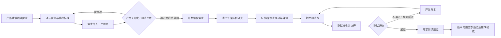
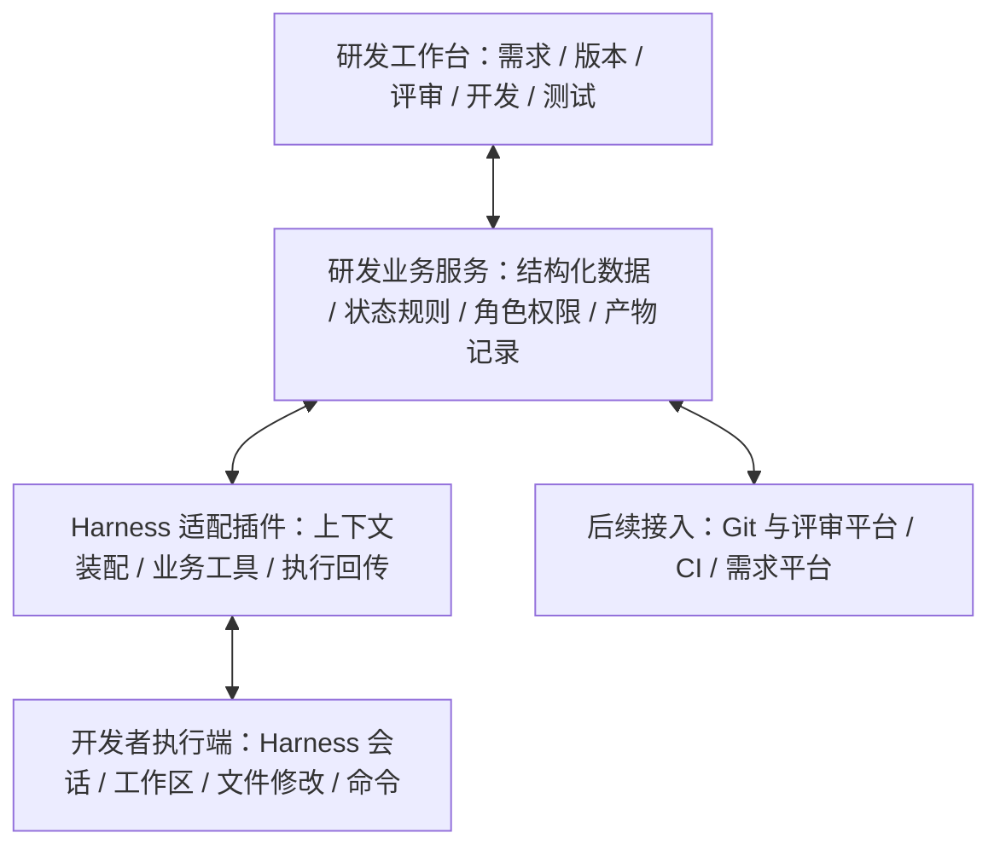

# Harness 研发：AI Native 研发流程设计草案

> 此文件保留初版方案。用户选择图 1 并提供完整流程图后，最新方向已修订为 [V2：版本主线与 AI 对话主工作区](/Users/wangyang/ai/ai_deepseek_harness/docs/design/2026-10-03-ai-native-rd-direction-v2.md)。六阶段、AI 布局、UAT 和完整版本完成条件以 V2 为准。

日期：2026-10-03（Asia/Shanghai）
范围：产品方向、首期功能、流程规则与界面设计。尚未实施业务功能。
本次目录：`/Users/wangyang/ai/ai_deepseek_harness`。开始设计时为空目录，尚未初始化 Git 或检出 Harness。

## 1. 推荐方向

**以版本组织交付，以需求贯穿协作，以对话推进工作，以可追溯产物完成交接。**

产品通过对话形成结构化需求，选择目标版本；产品、开发、测试共同完成版本需求评审；开发从已通过的需求进入自己选择的代码工作区，与 AI 协作修改和验证；开发提交明确的测试包；测试执行用例、记录问题，驱动修复和回归，最终形成版本测试结论。

首期按桌面 Web、团队共用需求与版本数据、开发者本地 Harness 执行的模式设计。跨成员身份与工作区归属需要作为业务模块建设，不能假定安装开源 Harness 后已具备。

推荐默认首页采用「版本中心」。对话创建需求和开发工作区作为主流程中的专用工作页面，同时让右侧 AI 随当前版本、需求和阶段切换上下文。

## 2. 首期用户与职责

| 角色 | 主要工作 | 需要确认的结论 |
|---|---|---|
| 产品 / 版本负责人 | 对话创建需求、维护范围和验收标准、需求入版、发起评审 | 需求内容与版本范围 |
| 开发 | 评审可行性与依赖、选择工作区、实现与自测、提交测试、修复问题 | 技术可行性、代码变更、提测材料 |
| 测试 | 评审可测试性、整理测试用例、执行测试、提出缺陷、回归 | 实际测试结果与版本测试结论 |
| AI 助手 | 追问、整理草稿、发现缺口、拆解工作、修改代码、运行已配置检查、整理报告 | 输出建议和执行证据；不自行替代角色审批 |

同一成员可兼任角色，但记录中保留实际操作者和当时角色。第一期支持项目成员和三个业务角色，不先建设复杂的组织层级。

## 3. 完整流程

这条主线允许同一版本的多项需求并行开发和提前提测。界面必须同时展示版本整体阶段和每项需求自己的状态，不能让版本上的单个进度条掩盖局部阻塞。

## 4. 首期功能

### 4.1 对话创建需求

- 输入一句自然语言，或补充截图、文档等材料；AI 追问影响实现和验收的关键缺口。
- 左侧对话、右侧实时需求草稿；人工可以直接编辑草稿。
- 草稿字段：标题、用户目标、使用场景、功能范围、不做范围、验收标准、异常场景、优先级、负责人、附件。
- 提供「仅保存草稿」「保存并加入版本」。后者要求显式选择版本，保存后进入该版本待评审列表。
- 需求修改产生修订号，保留变更记录；AI 提出的待确认假设在文档中标明。
- 对话中的一次确认只推进当前动作；保存需求不表示评审通过。

### 4.2 需求池与版本规划

- 需求池支持按状态、负责人和版本筛选，可从需求池批量加入版本。
- 创建版本时填写版本名、目标、负责人、计划提测日期和评审参与者。
- 第一阶段，一条需求最多归属一个活动版本；需要跨版本交付时拆分为可独立验收的子需求，保留关联。
- 版本详情显示需求范围、各角色待办和当前阻塞项；AI 可解释阻塞及建议下一步。
- 入版时检查需求基本字段与验收标准；缺项可保留草稿，但不能作为正式评审的完整输入。

### 4.3 版本需求评审

- 评审围绕版本范围内的需求开展，产品、开发、测试分别记录结论。
- 产品检查目标与范围；开发检查方案、依赖和工作量；测试检查验收标准和可测试性。
- AI 预审生成风险、冲突、遗漏和待回答问题，结论仍由对应角色提交。
- 评审结论为「通过」「需修改」。阻塞意见必须解决；普通建议可记录为不阻塞并说明原因。
- 所有必需评审结论完成且无未解决阻塞项，才可「通过并进入开发」。
- 通过后形成版本评审基线：版本范围、需求修订号、评审轮次和各角色结论。
- 通过后的范围或验收标准变更走新一轮评审；受影响任务标记「需求已变更」，重新确认前暂停受影响实现。历史评审记录不覆盖。

### 4.4 开发工作台与工作区选择

- 开发从版本或个人待办中选择已通过评审的需求，指定负责人并创建开发任务。
- 开始执行前必须选择：执行机器、仓库工作区、基准分支、工作分支；显示连接状态和未提交修改提示。
- 默认建议在独立分支或 worktree 中实施；既有未提交改动保留，不自动清理、重置或覆盖。
- 平台不能仅凭网页输入的本地路径访问开发者电脑。开发者安装并连接本地 Harness 执行端，再从登记的工作区中选择。
- 任务绑定具体需求基线与工作区。执行中不直接更换路径；停止当前执行后才能重新绑定并建立新的执行记录。
- 同一工作目录同一时刻只允许一个写任务，避免相互覆盖。
- AI 获取已评审需求、相关仓库规范及测试建议，输出实施计划，并在任务授权范围内修改代码和运行检查。
- 中间区域展示计划、变更文件、代码差异、检查结果；右侧可持续对话、补充约束、暂停和继续。
- 「AI 运行中 / 待输入 / 已停止 / 执行失败」与「需求开发中 / 待测试」分开显示。执行结束不自动改变业务验收结论。

### 4.5 提测交接

- 开发查看实际变更与自测结果后点击「提交测试」。
- 一次提测形成不可变的提测批次，关联需求修订、代码提交 SHA、变更摘要、构建包及标识、环境、测试负责人、自测报告和已知问题。
- 第一阶段允许人工附加构建包或填写可访问的构建链接，不强制先打通 Jenkins。
- 自动检查必填材料；失败或未运行的检查必须如实展示。测试负责人可因包不可用、环境缺失等退回补充，保留原因。
- 同一需求再次修改代码或构建包后，必须发起新批次。旧测试结果保留在旧批次，不自动沿用为新包通过。
- 开发自测和测试验收各自保留结果，不能互相替代。

### 4.6 测试执行与缺陷回流

- 测试台按版本和提测批次展示待测试项，始终显示正在测的需求基线、代码提交、构建包和环境。
- AI 根据验收标准整理候选用例、异常场景和回归建议；测试人员确认用例后执行。
- 第一阶段必须支持人工执行与证据上传；自动化只执行项目已配置且可运行的测试。
- 每条用例记录通过、失败、阻塞、未执行以及结果附件；AI 没有执行证据时不能写成通过。
- 缺陷包含复现步骤、期望与实际结果、严重程度、截图/日志和对应提测批次。
- 缺陷指派回开发，修复后发起新的提测批次，由测试验证后关闭。
- 版本完成条件：当前版本范围内全部需求的有效批次通过，必测用例执行完成，无未关闭阻塞缺陷，并由测试负责人记录版本结论。

### 4.7 我的工作与全程上下文

- 产品看到待补充需求、待排期和待评审事项；开发看到待领取、执行中、被退回和待修复事项；测试看到待评审、待接收和待回归事项。
- 首页突出「当前需要我做什么」，任务列表点击后进入对应版本或需求。
- 每个需求汇总对话、需求修订、评审、开发任务、提交、提测批次、测试结果和缺陷。
- 点击版本、需求或批次会同步切换 AI 上下文；输入区明确显示正在处理哪个对象。
- 阶段之间传递结构化产物与引用，用户不必反复粘贴之前的需求和评审结论。

## 5. 状态与变更规则

| 对象 | 正常状态 | 异常或回流 |
|---|---|---|
| 需求 | 草稿 → 待排期 → 待评审 → 待开发 → 开发中 → 待测试 → 测试中 → 测试通过 | 评审需修改；测试失败进入修复中；修复后重新提测 |
| 版本 | 规划中 → 评审中 → 开发中 → 测试中 → 已验收 | 范围变更开启新评审轮次；取消单独记录 |
| 评审轮次 | 待开始 → 进行中 → 通过 / 需修改 | 新修订不能继承旧修订审批 |
| AI 执行 | 待运行 → 运行中 → 已完成 / 待输入 / 失败 / 已停止 | 重试保留原记录并建立新的执行尝试 |
| 提测批次 | 待接收 → 测试中 → 通过 / 不通过 / 退回补充 | 新代码或新包必须新建批次 |

版本进入开发中后，允许局部需求先进入测试。所有当前范围内需求都有有效提测批次并被测试接收后，版本进入测试中。测试阶段出现缺陷时版本保持测试中，并显示修复阻塞；开发任务自身进入修复中。这样版本阶段保持可解释，局部工作也不被隐藏。

移出尚未开始的需求可以回到需求池。已评审或已开发的需求要通过范围变更处理，保留评审与交付关系，不能直接拖动后丢失历史。

## 6. 信息架构与主要页面

固定左侧导航：**我的工作 / 需求池 / 版本 / 工作区 / 测试**。项目切换在顶部，成员与连接设置置于辅助入口。

| 页面 | 核心内容 | 主要操作 |
|---|---|---|
| 我的工作 | 我的待办、阻塞、最近处理的版本 | 继续当前工作 |
| 需求对话页 | 对话、同步生成的需求文档、版本选择 | 保存并加入版本 |
| 需求池 | 全部需求、状态、优先级、负责人、版本 | 新建需求、纳入版本 |
| 版本详情 / 评审页 | 六阶段主线、需求列表、角色结论、评审意见、AI 上下文 | 发起 / 完成评审；进入开发 |
| 开发任务页 | 需求基线、工作区、实施计划、差异、自测 | 开始开发；提交测试 |
| 测试执行页 | 提测批次、包与环境、用例执行、缺陷和回归 | 记录结果；退回修复；测试通过 |

右侧 AI 是当前页面的协作区，不要求每个页面都占同样宽度。需求澄清时对话可占主区，开发时代码与任务占主区，测试时用例与证据占主区。

## 7. 本轮视觉方向

本轮生成三张独立桌面设计图，目标画布 1440 × 1024，均为示例数据与概念界面。

原图按本轮对话中的展示顺序保存：

- [图 1：版本评审](/Users/wangyang/ai/ai_deepseek_harness/output/imagegen/01-version-review.png)
- [图 2：对话创建需求](/Users/wangyang/ai/ai_deepseek_harness/output/imagegen/02-conversation-requirement.png)
- [图 3：工作区开发与提测](/Users/wangyang/ai/ai_deepseek_harness/output/imagegen/03-workspace-handoff.png)
- [完整生成提示词](/Users/wangyang/ai/ai_deepseek_harness/docs/design/image-prompts.md)

| 方向 | 展示场景 | 优势与取舍 |
|---|---|---|
| 版本指挥台（推荐整体结构） | v1.8.0 版本评审，需求列表与 AI 评审建议 | 跨角色交接清晰，适合团队默认首页；深度编写需求需要进入专用页面 |
| 对话需求台 | 产品聊天，右侧形成需求，选择版本并保存 | 创建需求自然，AI Native 特征直观；团队版本全貌需要单独入口 |
| 研发任务舱 | 开发确认工作区、变更、自测和提测材料 | 开发执行与交接清晰；产品和测试应有相应业务视图 |

推荐最终采用版本指挥台的信息架构，将对话需求台和研发任务舱作为流程中的专用页面。第一期的测试页面沿用相同结构：左侧批次、中间用例与结果、右侧 AI 建议，上方常驻包和环境信息。视觉细节在本轮反馈后统一。

图 2 中的自动保存指对话草稿持久化；只有点击保存操作才创建正式需求。正式界面应将状态文案统一为「尚未创建正式需求」，避免与「草稿自动保存」混淆。图 3 的「切换工作区」在任务执行中禁用，停止后可重新绑定并创建执行记录。

## 8. 与 DeepSeek Harness 的关系

截至 2026-10-03，已阅读官方 README、架构文档与 Web UI 指南。官方文档描述了基于 Cordis 的插件机制、会话日志、工具与 Agent 执行，以及工作区选择后读写文件和运行命令的能力。官方仓库仍标注 developer preview。

建议采用三层分工；以下属于本项目提案，并非声称官方已有完整研发流程：

- 复用 Harness 的执行和会话能力，通过自定义 profile 和插件接入业务上下文。
- 新建业务数据服务保存需求、版本、评审、任务、提测与测试记录。聊天记录不是业务状态的唯一来源。
- 对话动作和页面按钮调用同一组业务接口，执行相同的角色与状态检查；请求附带对象修订和幂等标识，避免重复执行或旧页面覆盖新结论。
- 中央业务服务保存团队共享信息；开发者执行端连接自己的工作区。路径与文件操作在选定执行端校验，不能把服务端文件系统误认为开发者本地目录。
- 执行端断线、工具失败、构建失败时保留已有产物和错误状态；重新连接后可继续，不自动认定开发或测试成功。
- 上游仍快速迭代，实施时锁定具体版本或提交，通过适配层隔离变更；本轮不指定未经验证的依赖版本。

## 9. 最小数据闭环

| 核心对象 | 关键关联 |
|---|---|
| 项目与成员 | 角色、版本、需求、仓库与执行端 |
| 需求 / 需求修订 | 原始对话、当前文档、验收标准、版本归属 |
| 版本 / 范围基线 | 需求修订集合、负责人、当前阶段 |
| 评审轮次 / 结论 | 版本范围基线、评审人、角色、阻塞意见 |
| 开发任务 / 执行记录 | 已评审修订、负责人、机器、工作区、分支、Harness 会话 |
| 提测批次 | 需求基线、提交 SHA、构建包、环境、自测、接收人 |
| 用例 / 测试执行 / 缺陷 | 提测批次、结果、证据、修复任务、回归结论 |
| 活动记录 | 操作者、动作、时间、对象修订、前后状态与产物引用 |

首期优先保证这条链路可查询和追溯，不先建设通用低代码流程引擎或复杂 AI 自治调度。

## 10. 交付顺序与首期边界

1. 先打通需求对话、需求池、版本归属和三角色评审，验证需求能从自然语言稳定变成可开发基线。
2. 接入工作区登记、开发任务和 Harness 执行，展示实际差异与检查结果。
3. 补齐提测批次、人工测试、缺陷回流与版本结论，完成首期全流程。

这三步合起来才是本次首期目标，前两步单独完成不能称为研发流程已交付。

首期不纳入自动生产发布、复杂排期、工时绩效、全自动测试平台、自主多 Agent 团队，以及同时集成所有外部研发系统。Git 提交关联、构建链接和日志附件先支持手工录入；后续按团队真实工具接入 Gerrit/GitHub、Jenkins、PMP 等。

## 11. 首期完成的可检查标准

- 产品用对话创建一条需求，编辑验收标准，并将其加入一个真实版本。
- 未通过版本评审的需求无法启动开发任务；评审通过后可查看确切的已评审修订。
- 开发可在自己登记的两个工作区之间明确选择一个，执行只发生在被选中的工作区。
- 一次代码变更能关联到需求、开发任务和实际提交；检查失败不会被显示成通过。
- 提测记录能固定对应的需求修订、代码、包、环境与自测证据。
- 测试发现问题后可退回开发；修复后形成新提测批次并完成回归，旧批次结果仍可追溯。
- 一个版本的全部需求完成测试且无阻塞缺陷后，由测试负责人给出版本验收结论。
- 刷新页面或 AI 会话中断后，需求与流程状态仍存在；产品、开发、测试看到同一套业务事实。

## 12. 来源与设计说明

- [DeepSeek Harness 官方仓库与 README](https://github.com/deepseek-ai/deepseek-harness)
- [官方架构：插件、profile、会话和扩展机制](https://github.com/deepseek-ai/deepseek-harness/blob/master/docs/architecture.md)
- [官方 Web UI 指南：工作区选择与任务执行](https://github.com/deepseek-ai/deepseek-harness/blob/master/docs/user/guide/index.md)

界面中的人员、版本、需求、文件、提交与测试结果均为设计示例，不代表真实系统已完成这些操作。设计图使用内置 Image Gen 生成，提示词保存在同目录的 `image-prompts.md`。
